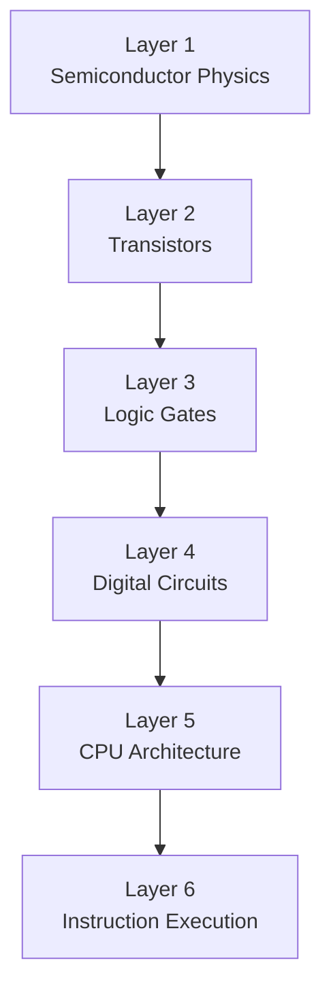

<div align="center">

#  LogicVerse

### From Silicon to Code: an interactive digital electronics learning platform

*Explore digital electronics through hands-on, visual simulations, from semiconductor physics all the way to CPU instruction execution.*

[](https://developer.mozilla.org/en-US/docs/Web/HTML)
[](https://developer.mozilla.org/en-US/docs/Web/CSS)
[](https://developer.mozilla.org/en-US/docs/Web/JavaScript)
[](#-academic-information)
[](#-credits--license)

[Overview](#-overview) · [Features](#-features) · [Learning Layers](#-the-six-learning-layers) · [Getting Started](#-getting-started) · [Structure](#-project-structure) · [Roadmap](#-roadmap)

</div>

---

##  Overview

**LogicVerse** is a browser-based digital electronics learning platform built for the *Foundations of Intelligent Digital Systems (FOIDS)* course. It makes abstract concepts easier to grasp by letting you *see* and *interact* with them.

It combines two complementary simulators:

| Module | What it covers | Open |
|---|---|---|
|  **Logic Circuit Simulator** | Logic circuits, Boolean expressions, gate operations, truth tables and K-map tools | [`logic-simulator/index.html`](logic-simulator/index.html) |
|  **Full Digital Electronics Simulator** | A guided journey from semiconductor physics to CPU execution | [`full-simulator/index.html`](full-simulator/index.html) |

No build step, no dependencies: just open it in a browser.

---

##  Features

###  Logic Circuit Simulator

- Interactive logic-circuit workspace
- Boolean-expression analysis
- Logic-gate operations
- Truth-table tools
- Boolean-expression simplification
- Karnaugh map (K-map) minimization
- Visual representation of digital logic

###  Full Digital Electronics Simulator

- Six connected learning layers, each in its own module
- Visual exploration from semiconductor physics to instruction execution
- Fully browser-based interface

> **Note:** The exact availability of individual controls depends on the current implementation in the repository. Check each simulator before assuming every listed capability is complete.

---

##  The Six Learning Layers

The Full Simulator builds understanding from the ground up, with each layer resting on the one below it.



| # | Layer | Learning focus |
|:-:|---|---|
| 1 |  Semiconductor Physics | Foundations of semiconductor devices |
| 2 |  Transistors | Transistors as electronic switches |
| 3 |  Logic Gates | Basic digital gates and their operations |
| 4 |  Digital Circuits | Combining gates into larger circuits |
| 5 |  CPU Architecture | Fundamental CPU components |
| 6 |  Instruction Execution | How instructions are processed and executed |

---

##  Project Objectives

- Understand the fundamentals of digital electronics
- See how semiconductor devices form the foundation of digital systems
- Understand transistor switching
- Learn how logic gates operate
- Explore Boolean algebra and logic-circuit design
- Connect individual gates to larger digital systems
- Understand basic CPU architecture and instruction execution
- Support learning through visual demonstrations

---

##  Getting Started

### Requirements

- A modern web browser (Chrome, Firefox, Edge or Safari)
- *Optional:* [Git](https://git-scm.com/) for cloning
- *Optional:* [VS Code](https://code.visualstudio.com/) with the Live Server extension

### Quick start

```bash
# 1. Clone the repository
git clone https://github.com/shreyas-landge/LogicLab.git

# 2. Enter the project directory
cd LogicLab
```

Then either:

- **Open the root `index.html`** in your browser, or
- **Use VS Code Live Server:** right-click `index.html` → *Open with Live Server*

### Jump straight to a simulator

| Simulator | Path |
|---|---|
| Logic Circuit Simulator | `logic-simulator/index.html` |
| Full Digital Electronics Simulator | `full-simulator/index.html` |

---

##  Project Structure

```text
LogicLab/
├── index.html                  # Landing page
├── README.md
│
├── logic-simulator/            # Logic Circuit Simulator
│   ├── index.html
│   ├── app.js                  # App wiring and UI
│   ├── circuit.js              # Circuit workspace
│   ├── logic.js                # Gate and Boolean logic
│   ├── kmap.js                 # K-map minimization
│   ├── style.css
│   └── README.md
│
└── full-simulator/             # Full Digital Electronics Simulator
    ├── index.html
    ├── main.js
    ├── simulator.js
    ├── utils.js
    ├── style.css
    ├── layer1-physics.js
    ├── layer2-transistor.js
    ├── layer3-gates.js
    ├── layer4-circuits.js
    ├── layer5-cpu.js
    └── layer6-execution.js
```

---

##  Learning Outcomes

By working through the implemented modules, you can study:

- Semiconductor fundamentals
- Transistor switching
- Basic and derived logic gates
- Boolean algebra
- Truth tables
- Sum of Products (SOP) and Product of Sums (POS)
- Minterms and maxterms
- Karnaugh map simplification
- Combinational digital circuits
- Basic CPU architecture
- Instruction-execution concepts

---

##  Technology Stack

| Technology | Role |
|---|---|
| HTML5 | Page structure |
| CSS3 | Styling and layout |
| JavaScript | Interactive behavior and simulation logic |
| Git & GitHub | Version control and hosting |

---

##  Roadmap

- [ ] Sequential-circuit simulations
- [ ] Flip-flops and registers
- [ ] Counters and shift registers
- [ ] Expanded CPU architecture demonstrations
- [ ] Guided experiments and practice exercises
- [ ] Improved simulation controls and visual explanations
- [ ] More interactive circuit components

---

##  Academic Information

| | |
|---|---|
| **Project** | LogicVerse: Interactive Digital Electronics Simulator |
| **Developer** | Shreyas Landge |
| **Subject** | Foundations of Intelligent Digital Systems (FOIDS) |
| **Program** | B.Tech, Artificial Intelligence and Data Science |
| **Institution** | Vishwakarma Institute of Technology, Pune |

---

##  Credits & License

Created and developed by **Shreyas Landge**.

The Logic Circuit Simulator component is adapted from the open-source *Logic Simulator*. The original **MIT License** and applicable copyright notices must be retained with the reused code. Refer to the applicable license file for full terms.

---

<div align="center">

**LogicVerse: From Silicon to Code**

Developed by [Shreyas Landge](https://github.com/shreyas-landge)

[](https://github.com/shreyas-landge/LogicLab)

</div>
