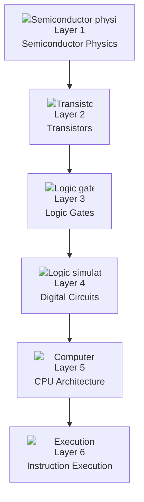

::: {align="center"}
# LogicVerse

### From Silicon to Code --- An Interactive Digital Electronics Learning Platform

**Explore digital electronics through interactive visual simulations.**

[ Explore Repository](https://github.com/shreyas-landge/LogicLab) ·
[Project Structure](#-project-structure) · [🛠️ Getting
Started](#-getting-started) · [License](#-credits-and-license)
::: Quick Navigation

<strong>{=html}Click to expand or collapse the
contents`</strong>`{=html}

-  Project Overview
-  Features
-  Six Learning Layers
-  Project Objectives
-  Technology Stack
-  Project Structure
-  Getting Started
-  Learning Outcomes
-  Future Enhancements
-  Academic Information
-  Credits and License

 Project Overview
LogicVerse is an interactive digital electronics learning platform
developed as part of the Foundations of Intelligent Digital Systems
(FOIDS) course.

It brings together two complementary learning environments:
  Module                  What it covers          Open locally
   Logic Circuit      Logic circuits, Boolean [`logic-simulator/index.html`](logic-simulator/index.html)
Simulator             expressions, logic
operations and K-map
tools                   
 Full Digital       A learning journey from [`full-simulator/index.html`](full-simulator/index.html)
Electronics Simulator semiconductor physics
to CPU execution
The aim is to make abstract digital-electronics concepts easier to
explore through visual and interactive demonstrations.
 Features

<strong>{=html} Logic Circuit Simulator`</strong>`{=html}

- Interactive logic-circuit workspace.
- Boolean-expression analysis.
- Logic-gate operations.
- Truth-table tools.
- Boolean-expression simplification.
- Karnaugh map (K-map) minimization.
- Visual representation of digital logic.

<strong>{=html} Full Digital Electronics Simulator`</strong>`{=html}

- Six connected learning layers.
- Visual exploration of concepts from semiconductor physics to
  instruction execution.
- Separate modules for each layer.
- Browser-based interface.

Note: The exact availability of individual controls depends on the
current implementation in the repository. Check each simulator before
treating every listed capability as complete.

 Six Learning Layers
The Full Digital Electronics Simulator is organized into six layers:

  Layer   Topic                      Learning focus
  1        Semiconductor Physics   Foundations of semiconductor devices
2        Transistors             Transistors as electronic switches
3        Logic Gates             Basic digital gates and their operations
4        Digital Circuits        Combining gates into digital circuits
5        CPU Architecture        Fundamental CPU components
6        Execution               How instructions are processed and executed
 Project Objectives
-  Understand the fundamentals of digital electronics.
-  Explore how semiconductor devices form the foundation of digital
  systems.
-  Understand transistor switching.
-  Learn the operation of logic gates.
-  Explore Boolean algebra and logic-circuit design.
-  Connect individual gates to larger digital systems.
-  Understand basic CPU architecture and instruction execution.
-  Support learning through visual demonstrations.
 Technology Stack
::: {align="center"}

:::  Technology   Role
  HTML5        Page structure
CSS3         Styling and layout
JavaScript   Interactive behavior and simulation logic
Git          Version control
GitHub       Source-code hosting
 Project Structure

<strong>{=html}Show repository tree`</strong>`{=html}

LogicLab/
│
├── index.html
├── README.md
│
├── logic-simulator/
│   ├── index.html
│   ├── app.js
│   ├── circuit.js
│   ├── logic.js
│   ├── kmap.js
│   ├── style.css
│   └── README.md
│
└── full-simulator/
    ├── index.html
    ├── main.js
    ├── simulator.js
    ├── utils.js
    ├── style.css
    ├── layer1-physics.js
    ├── layer2-transistor.js
    ├── layer3-gates.js
    ├── layer4-circuits.js
    ├── layer5-cpu.js
    └── layer6-execution.js

 Getting Started
Requirements
-  A modern web browser: Chrome, Firefox, Edge or Safari.
-  Git (optional, for cloning).
-  VS Code with Live Server (optional).
1. Clone the repository
git clone https://github.com/shreyas-landge/LogicLab.git
2. Enter the project directory
cd LogicLab
3. Run the project
Open the root index.html file in your browser.

Alternatively, open the project in VS Code and use the Live Server
extension.
4. Open a simulator directly
-  Logic Circuit Simulator: logic-simulator/index.html
-  Full Digital Electronics Simulator: full-simulator/index.html
 Learning Outcomes
By exploring the relevant implemented modules, learners can study:
- Semiconductor fundamentals.
- Transistor switching.
- Basic and derived logic gates.
- Boolean algebra.
- Truth tables.
- Sum of Products (SOP) and Product of Sums (POS).
- Minterms and maxterms.
- Karnaugh map simplification.
- Combinational digital circuits.
- Basic CPU architecture.
- Instruction-execution concepts.
 Future Enhancements
- [ ] Add sequential-circuit simulations.
- [ ] Add flip-flops and registers.
- [ ] Introduce counters and shift registers.
- [ ] Expand CPU architecture demonstrations.
- [ ] Add guided experiments and practice exercises.
- [ ] Improve simulation controls and visual explanations.
- [ ] Add more interactive circuit components.
 Academic Information
  Field             Details
  Project       LogicVerse --- Interactive Digital Electronics Simulator
Developer     Shreyas Landge
Subject       Foundations of Intelligent Digital Systems (FOIDS)
Program       B.Tech --- Artificial Intelligence and Data Science
Institution   Vishwakarma Institute of Technology, Pune
 Credits and License
Created and developed by Shreyas Landge.

The Logic Circuit Simulator component is adapted from the open-source
Logic Simulator.

The original MIT License and applicable copyright notices must be
retained with the reused code. Refer to the applicable license file for
licensing terms.
::: {align="center"}
### LogicVerse --- From Silicon to Code

**Developed by Shreyas Landge**

:::